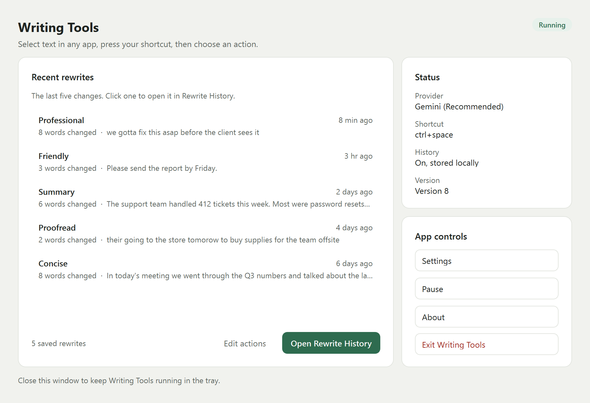
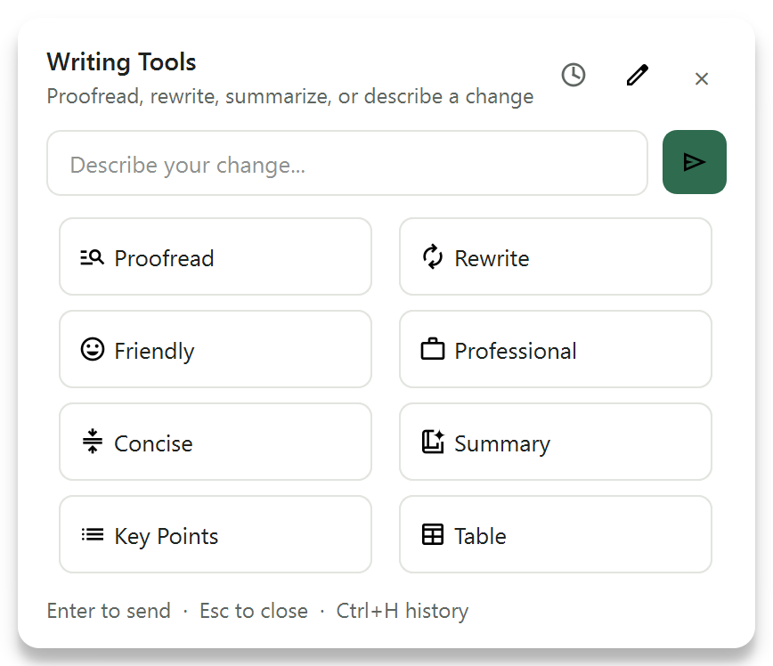
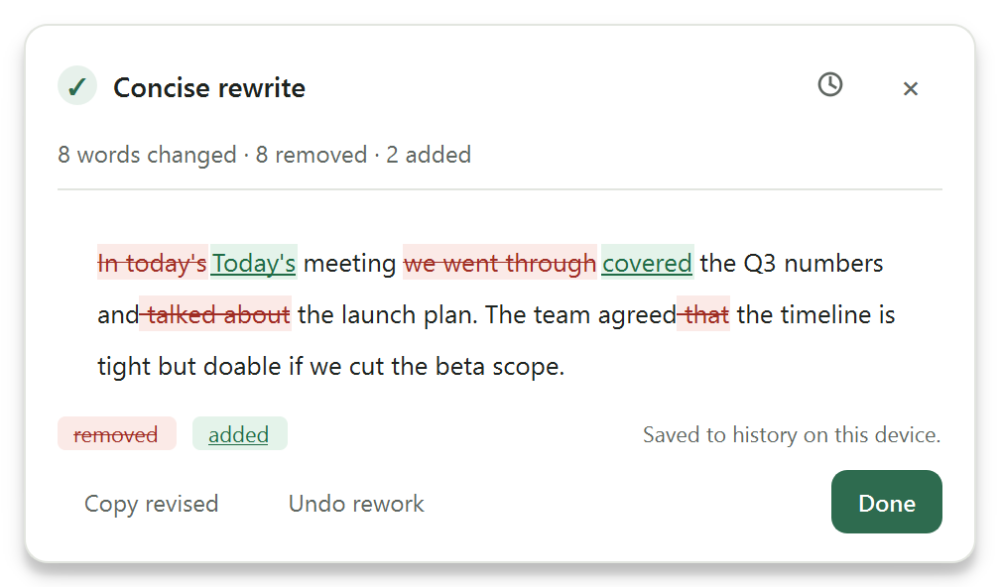
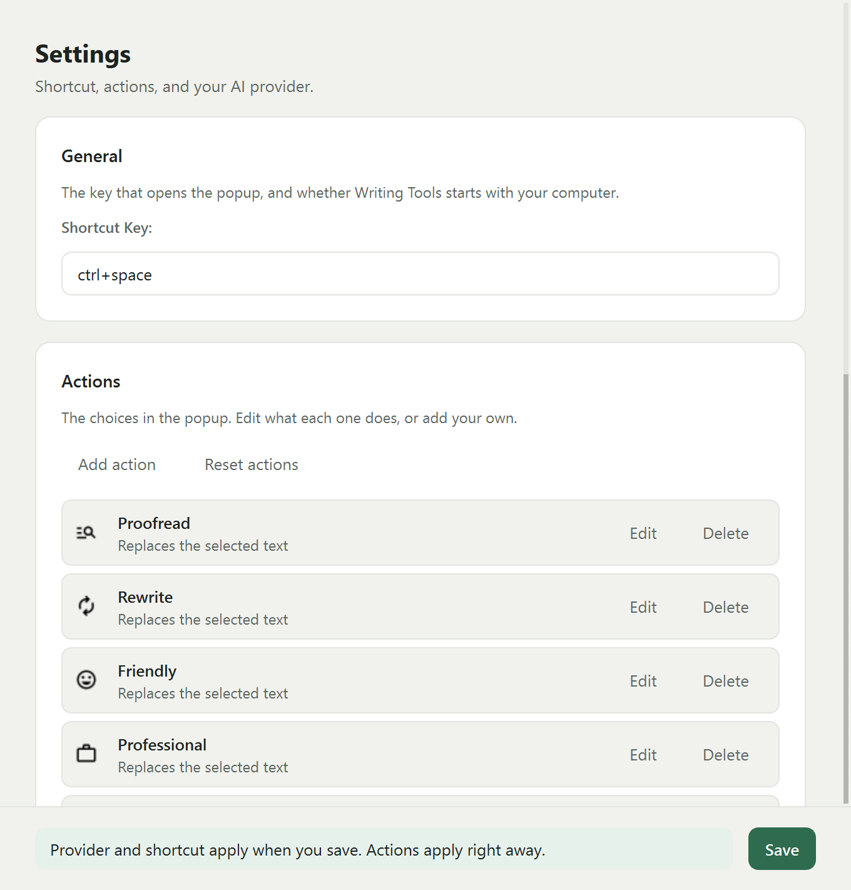
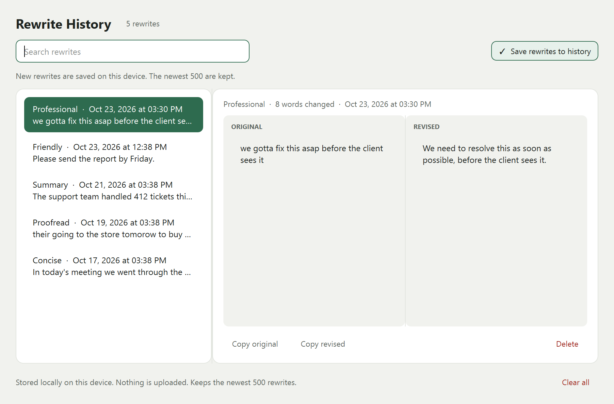
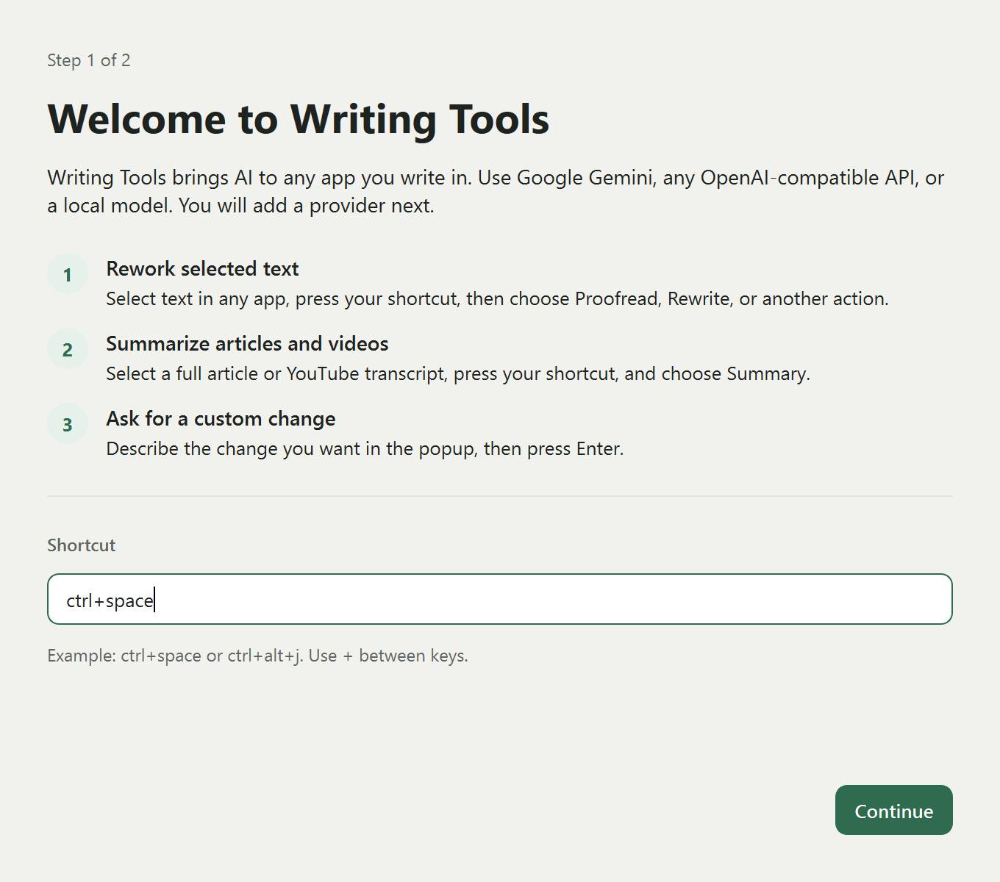
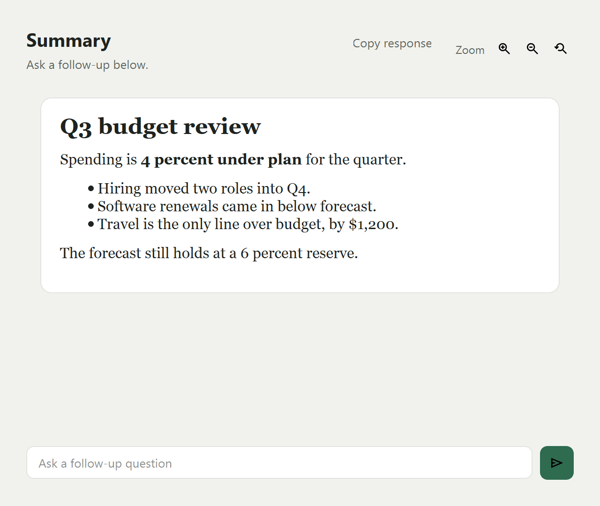

# Writing Tools

A system-wide AI writing tool for Windows and Linux. Select text in any app, press
`ctrl+space`, and choose an action. The revised text lands in place.



This is a fork of [theJayTea/WritingTools](https://github.com/theJayTea/WritingTools).
It keeps the instant in-place flow and adds a reviewable receipt, local rewrite
history, a real app window, and one paper design system. The macOS Swift port is
upstream and unchanged.

## What it does

- Proofread, rewrite, change tone, or run a custom instruction on selected text.
- Summarize, extract key points, or build a table in a result window with follow-ups.
- Show a receipt after every in-place rewrite, with a word-level diff and best-effort Undo.
- Keep a searchable local history of every rewrite.
- Let you edit the action list and provider from Settings.

## Screenshots

| Action popup | Rewrite receipt |
| --- | --- |
|  |  |

| Settings and actions | Rewrite history |
| --- | --- |
|  |  |

| First run | Result window |
| --- | --- |
|  |  |

Screenshots are rendered from the running Qt widgets, not mockups.

## The write loop

1. Select text in any app.
2. Press `ctrl+space`. The action popup opens where you are.
3. Choose an action, or type a custom instruction and press Enter.
4. The revised text is pasted in place. A receipt appears near the cursor.
5. Review the diff, undo, or open Rewrite History.

The app itself has a dashboard with recent rewrites, the provider, the shortcut,
and Settings, Pause, About, and Exit. A tray icon stays available. Closing the
window keeps the app running.

## Install

Requirements: Windows 10 or 11, or Linux, Python 3.11 or newer (3.13 is tested),
and an API key for Gemini or an OpenAI-compatible service, or a local Ollama server.

### Windows portable build

From the repository root:

```powershell
python -m venv .venv
.\.venv\Scripts\python.exe -m pip install -r Windows_and_Linux\requirements.txt
cd Windows_and_Linux
..\.venv\Scripts\python.exe pyinstaller-build-script.py
```

The build writes `dist\Writing Tools.exe` and copies `icons`, `locales`,
`pot_files`, `options.json`, and `Latest_Version_for_Update_Check.txt` beside it.
Keep those files together when you move the app. The build does not create a zip.

The config sits beside the exe. Rewrite History is stored in your app data
folder. Move the whole `dist` folder, not only the exe.

### Run from source

```powershell
cd Windows_and_Linux
..\.venv\Scripts\python.exe main.py
```

The demo renders the receipt and history without a provider:

```powershell
..\.venv\Scripts\python.exe -m rework.demo
```

### Linux

The Python app runs on Linux with the same commands. The build script targets
Windows. Autostart is Windows-only.

## First run

1. Choose the shortcut that opens the popup.
2. Choose an AI provider and add its details.
3. The dashboard opens. Select text anywhere and press the shortcut.

Settings is the home for the shortcut, Start on Boot, the action list, and the
provider. Action edits apply immediately. Provider and shortcut changes apply
when you click Save.

## Providers

- **Gemini (Recommended)** uses a Gemini API key.
- **OpenAI Compatible (For Experts)** takes an API key, base URL, and model, with optional organisation and project fields.
- **Ollama (For Experts)** takes a base URL, model, and keep-alive time.

You can switch providers in Settings. The form rebuilds for the selected provider,
and Save validates it before anything is written.

## Privacy

- Rewrite History is a local SQLite database. It is on by default, keeps the newest
  500 rewrites, and is never uploaded. You can search, copy, delete, or clear it,
  and turn saving off.
- The selected text is sent to the AI provider you choose when you run an action.
  History is local. The request is not.
- The clipboard is backed up before the paste and restored afterwards.
- A startup crash writes `crash.log` next to the exe.

## Build and test

```powershell
cd Windows_and_Linux
..\.venv\Scripts\python.exe -m unittest discover -s tests
```

The suite has 119 tests. The repository also ships a verification harness that
drives the real Qt widgets and writes evidence under `artifacts/verify`:

```powershell
.\.venv\Scripts\python.exe -B .opencode\skills\verify-writingtools\scripts\verify.py gate --run-id local
```

## Known limits

- Undo is best effort. It returns focus to the source window and sends `Ctrl+Z`,
  so it can revert your own last edit instead of the rewrite.
- Window-mode results have no Cancel once the result window opens.
- History is not encrypted.
- About reads version 8.
- The app follows the system light or dark setting. There is no manual override.
- The macOS Swift port is upstream and untouched by this fork.

## Upstream and license

Writing Tools was created by [Jesai Tarun](https://github.com/theJayTea) with
contributors, including the macOS port by Arya Mirsepasi. This fork keeps the
GPLv3 license and the upstream attribution. See [LICENSE](LICENSE),
[UPSTREAM.md](UPSTREAM.md), and [FORK.md](FORK.md).
