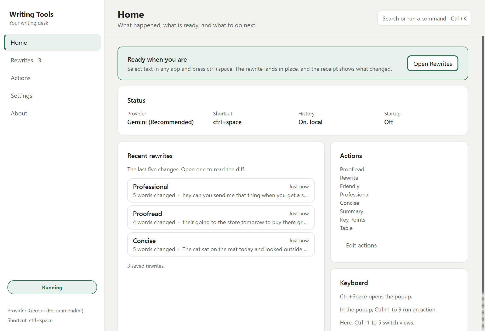
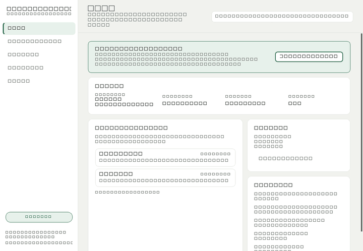
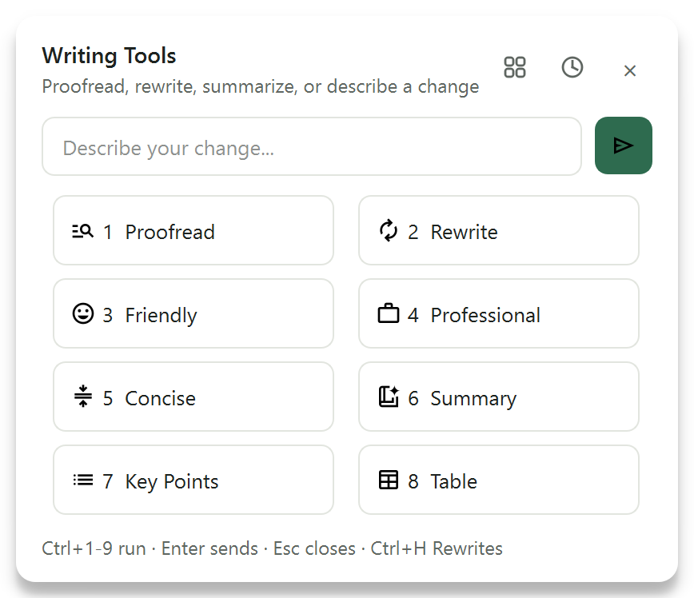
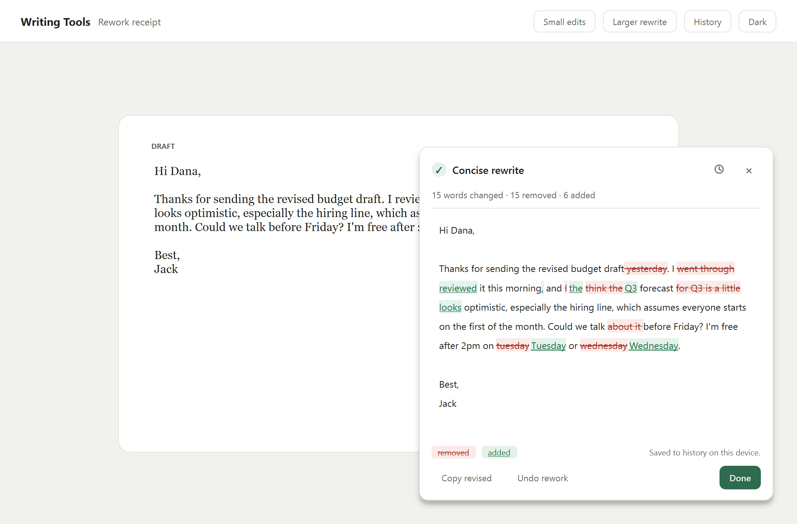
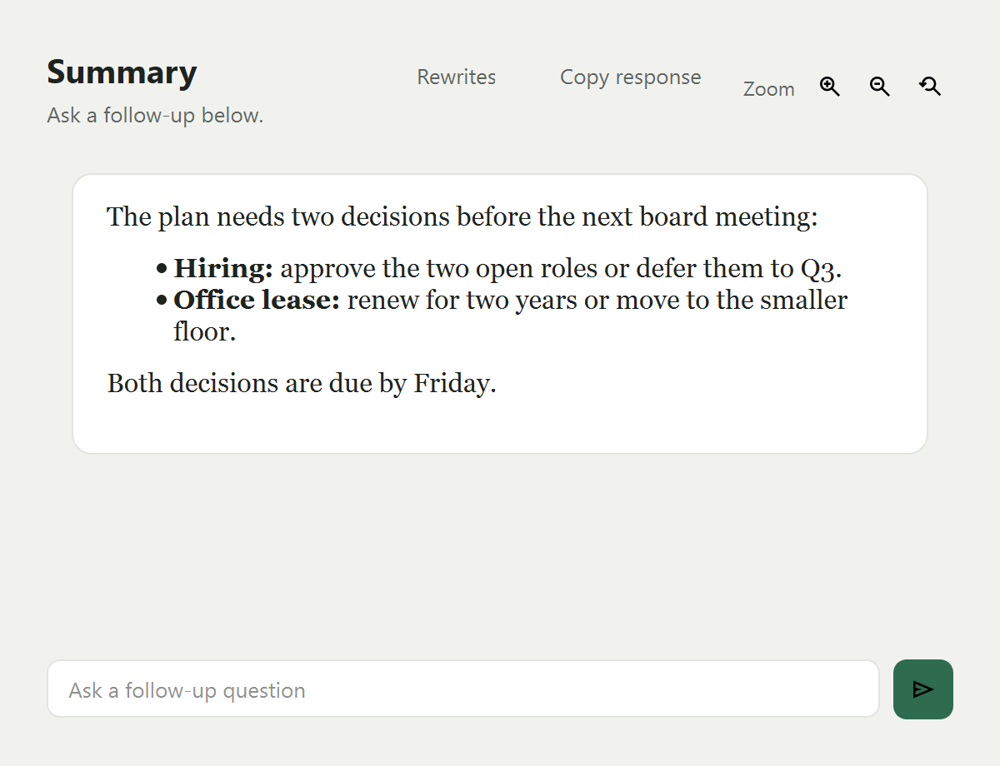
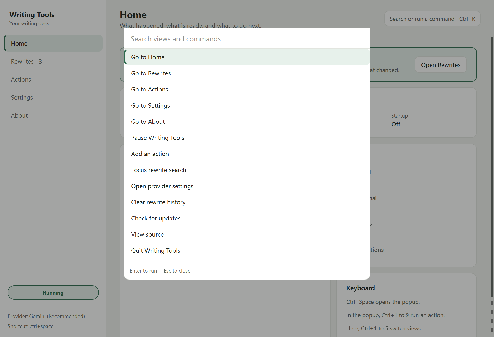
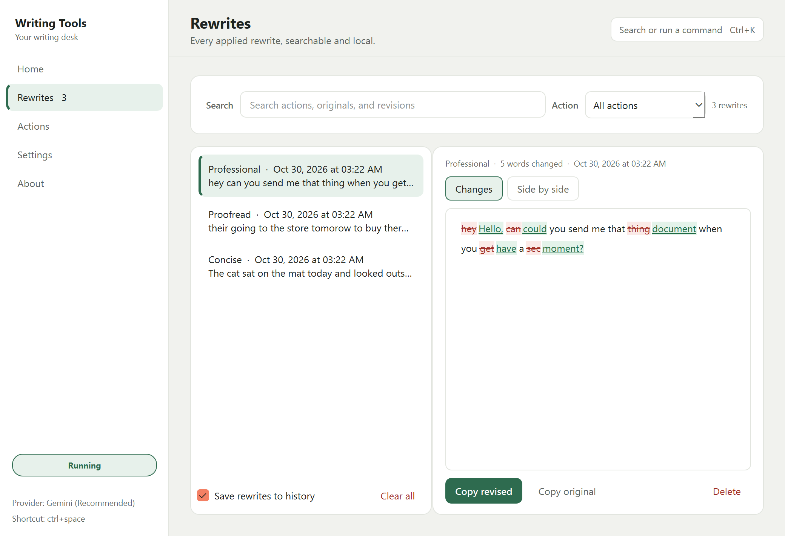
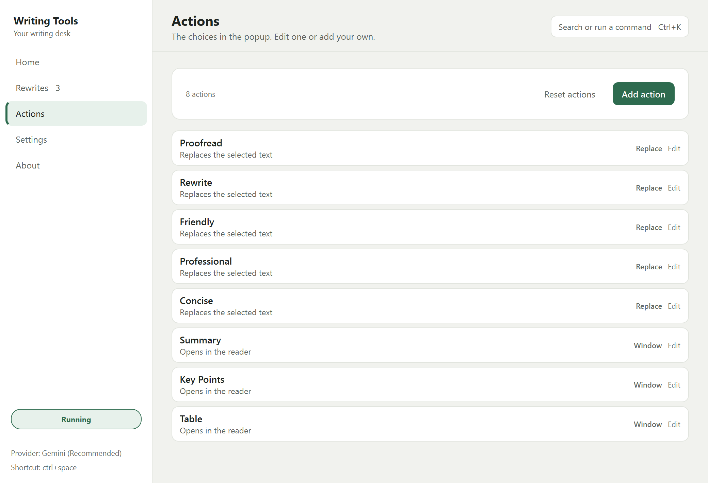
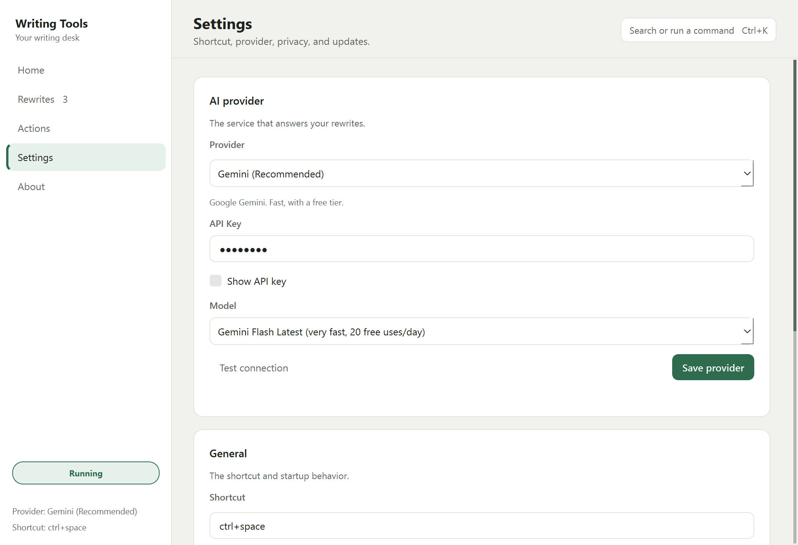
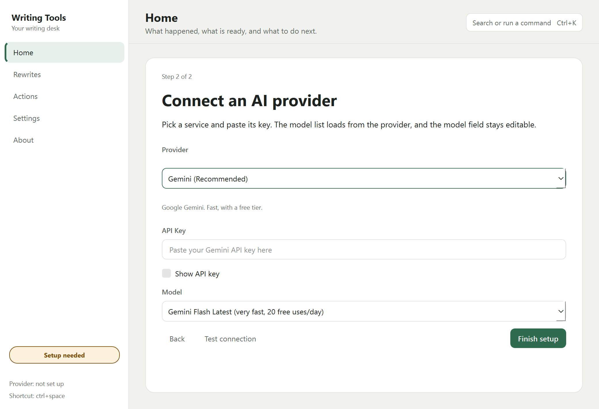

# Writing Tools

A system-wide AI writing tool for Windows and Linux. Select text in any app,
press `ctrl+space`, choose a rewrite, and the revision lands in place. One window
manages the rest.



## What it does

- Proofread, rewrite, change tone, or apply a custom instruction to selected text.
- Show a receipt after every in-place rewrite, with a word-level diff and best-effort Undo.
- Keep a searchable local history of every rewrite.
- Edit the popup actions, shortcut, and AI provider in one window.
- Start from a provider preset and load the provider's live model list.
- Read long results in a separate reader with follow-up chat.

## The write loop

1. Select text in any app.
2. Press `ctrl+space`.
3. Choose an action, or type a custom instruction and press Enter.
4. The revision is pasted in place. A receipt appears near the cursor.
5. Review the diff, undo, or open the rewrite in the app.

## See it move

[Watch the 10-second workflow](docs/media/workflow.mp4) or play the short loop:



The recording is captured from the real Qt window at 10 frames per second by the
verification harness.

## One window, one flow

The app is one shell with five views. Every management task lives there, so
Settings, history, actions, and About do not open new windows.

| Action popup | Rewrite receipt |
| --- | --- |
|  |  |

| Reader | Command palette |
| --- | --- |
|  |  |

| Home | Rewrites |
| --- | --- |
|  |  |

| Actions | Settings |
| --- | --- |
|  |  |

| First run |
| --- |
|  |

Press `ctrl+k` in the app to search views and commands. Press `ctrl+1` to
`ctrl+5` to switch views.

## Install

Requirements: Windows 10 or 11, or Linux, Python 3.11 or newer, and a key for
Gemini or an OpenAI-compatible service, or a local Ollama server.

### Windows portable build

[Download the latest portable zip](https://github.com/bitgineer/WritingTools/releases/latest).
Unzip it, keep the files together, and run `Writing Tools.exe`. The zip has no
config or API key. First run asks for both.

To build it yourself, from the repository root:

```powershell
python -m venv .venv
.\.venv\Scripts\python.exe -m pip install -r Windows_and_Linux\requirements.txt
cd Windows_and_Linux
..\.venv\Scripts\python.exe pyinstaller-build-script.py
```

The build writes `dist\Writing Tools.exe` and copies `icons`, `locales`,
`pot_files`, `options.json`, `provider_presets.json`, and
`Latest_Version_for_Update_Check.txt` beside it. Keep those files together.

The config sits beside the exe. Rewrite history is stored in your app data
folder. Move the whole `dist` folder, not only the exe.

### Run from source

```powershell
cd Windows_and_Linux
..\.venv\Scripts\python.exe main.py
```

Closing the window hides it to the tray. Quit from the tray menu or the
command palette to exit.

The demo renders the receipt and history without a provider:

```powershell
..\.venv\Scripts\python.exe -m rework.demo
```

### Linux

The Python app runs on Linux with the same commands. The build script targets
Windows. Autostart is Windows-only.

## First run

First run is a card in Home. It asks for the shortcut, then a provider. The app
keeps a tray icon from the first launch and registers the shortcut after the
provider is ready, then tells you the exact next action. Closing the window
before setup finishes keeps the app in the tray and resumes setup the next time
you open it.

## Providers

- **Gemini (Recommended)** uses a Gemini API key.
- **OpenAI Compatible (For Experts)** takes an API key, base URL, and model, with optional organisation and project fields.
- **Ollama (For Experts)** takes a base URL, model, and keep-alive time.

You can switch providers in Settings. The form rebuilds for the selected provider.
**Test connection** checks the service before you save. **Save provider** validates
the settings and writes nothing if they are incomplete.

### Quick setup presets

Choose a service in the OpenAI-compatible section and the base URL and model are
filled in, with a link to that service's key page. After you paste the key,
**Load models** asks the service for its model list and fills a picker. The model
field stays editable, so a provider without a list endpoint still works. The
catalog covers OpenAI, OpenRouter, Groq, DeepSeek, Mistral, xAI, Together AI,
Cerebras, Fireworks, Perplexity, NVIDIA, Nebius, and Hugging Face. It ships as
`Windows_and_Linux/provider_presets.json`, so adding a service is a data change,
not a new class. No keys are bundled.

## Privacy

- Rewrite history is a local SQLite database. It is on by default, keeps the newest
  500 rewrites, and is never uploaded. You can search, copy, delete, or clear it,
  and turn saving off.
- The selected text is sent to the AI provider you choose when you run an action.
  History is local. The request is not.
- The clipboard is backed up before the paste and restored afterwards.
- A startup crash writes `crash.log` next to the exe.

## Build and test

```powershell
cd Windows_and_Linux
..\.venv\Scripts\python.exe -m unittest discover -s tests
```

The repository also ships a verification harness that drives the real Qt widgets
and writes screenshots and a friction scorecard under `artifacts/verify`:

```powershell
.\.venv\Scripts\python.exe -B .opencode\skills\verify-writingtools\scripts\verify.py gate --run-id local
```

## Known limits

- Undo is best effort. It returns focus to the source window and sends `Ctrl+Z`,
  so it can revert your own last edit instead of the rewrite.
- Some providers gate specific free models to their own apps. The app names
  the gate and leaves the model field editable, so choose a standard model.
- A reader opened from a long result has no Cancel once it opens.
- History is not encrypted.
- The app follows the system light or dark setting. There is no manual override.
- The macOS Swift port is upstream and untouched by this fork.

## Upstream and license

Writing Tools was created by [Jesai Tarun](https://github.com/theJayTea) with
contributors, including the macOS port by Arya Mirsepasi. This fork keeps the
GPLv3 license and the upstream attribution. See [LICENSE](LICENSE),
[UPSTREAM.md](UPSTREAM.md), and [FORK.md](FORK.md).
